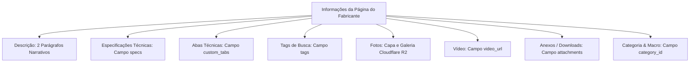

# Diretrizes & Modelo Oficial de Cadastro de Produtos — Athena

Este documento define o padrão oficial para pesquisa, formatação, divisão de campos e registro de produtos no catálogo do e-commerce da Athena Soluções Automotivas.

---

## 1. Padrão de Nomenclatura (Título do Produto)

O título de todo produto cadastrado deve seguir estritamente o formato:

```text
[Nome principal do produto] [Principais especificações] – [Marca] [Modelo/SKU]
```

### Exemplos:
* `Soquete de Impacto Sextavado Longo 1/2" 19mm – Sigma Tools SGT-1219`
* `Scanner Automotivo Diagnóstico Avançado com Programador IMMO – EAATA 360PRO`
* `Elevador Automotivo Eletro-Hidráulico 4 Toneladas com Placa de Piso – Lapek LPK-1000`

---

## 2. Separação Rigorosa dos Campos (O que vai onde?)

> [!IMPORTANT]
> **A descrição do produto NÃO deve conter especificações, abas, tags ou listas de itens inclusos.**
> Cada informação deve ser inserida exclusivamente no seu respectivo campo estruturado no banco de dados e no painel administrativo.



---

## 3. Detalhamento dos Campos

### 3.1. Campo `description` (Descrição Comercial)
Apenas texto narrativo em Markdown contendo **exatamente 2 parágrafos**:

* **Parágrafo 1 — Apresentação do Produto:**  
  Apresenta o equipamento de forma natural, dizendo exatamente o que é, para que serve e sua principal função. Destaca os pontos mais relevantes para o comprador com precisão técnica e sem promessas irreais ou exageros.
* **Parágrafo 2 — Funcionamento & Aplicação Prática:**  
  Explica resumidamente como opera, os recursos tecnológicos centrais e em quais situações da oficina/indústria ele resolve o problema do cliente, justificando a escolha do produto.

*(Nenhum título `## Especificações`, bullet points técnicos de dados ou tags devem permanecer neste campo).*

---

### 3.2. Campo `specs` (Especificações Técnicas)
Cadastrado diretamente no array/tabela de especificações técnicas:

* Modelo: `[modelo]`
* Tipo: `[tipo do produto / categoria técnica]`
* Tensão / Alimentação: `[ex: 220V Monofásico / Bivolt / Pneumático]`
* Capacidade / Medida / Torque: `[valores numéricos e unidades oficiais]`
* Material / Acabamento: `[ex: Aço Cromo-Molibdênio (Cr-Mo), Pintura Eletrostática]`
* Norma Técnica: `[ex: DIN 3129, se houver]`
* Código do Produto / SKU: `[código do fabricante ou código interno]`
* Código de Barras (EAN): `[se informado pelo fabricante]`

---

### 3.3. Campo `custom_tabs` (Abas Personalizadas)
Cada bloco complementar torna-se uma aba dedicada no produto:

| Seção | Título da Aba (`title`) | Regra de Preenchimento |
| :--- | :--- | :--- |
| **Diferenciais** | `Diferenciais` | Lista de benefícios e diferenciais comprovados pelo fabricante. |
| **Aplicações** | `Aplicações` | Serviços, tipos de veículos, oficinas e setores recomendados. |
| **Acompanha / Itens Inclusos** | `Itens Inclusos` | Lista de componentes inclusos na caixa/maleta. *(Se não houver informação oficial de itens inclusos, esta aba não deve ser criada).* |
| **Composição de Jogo / Kit** | `Composição do Kit` | Tabela ou lista de ferramentas inclusas em jogos de soquetes/chaves. |
| **Tabela de Medidas** | `Tabela de Medidas & Códigos` | Para famílias de ferramentas com tabelas dimensionais completas. |
| **Módulos / Compatibilidade** | `Módulos Compatíveis` | Para scanners, centrais eletrônicas (ECUs) e adaptadores. |
| **Informações Técnicas / Cuidados** | `Informações Importantes` | Orientações de segurança, licenças de software ou requisitos de uso. |

---

### 3.4. Campo `tags` (Tags de Busca & SEO)

> [!IMPORTANT]
> **Regra de Quantidade de Tags (Volume Estratégico por Perfil de Produto):**
> * **40 a 50 tags:** Produto simples / específico (ex: ferramentas manuais focadas, alicates especiais, soquetes avulsos, adaptadores individuais).
> * **50 a 60 tags:** Produto com muitas aplicações e ampla busca (ex: chaves de impacto, sangradores de freio, analisadores de bateria, máquinas de limpeza de bicos, jogos de ferramentas).
> * **60 a 70 tags:** Produto muito abrangente, com múltiplas especificações, ampla gama de compatibilidades ou sistemas complexos (ex: scanners de diagnóstico, alinhadores 3D, elevadores automotivos, desmontadoras de pneus, estações de carga EV).

#### Como distribuir e compor o conjunto de tags:
1. **Identificação Primária:** Nome exato do produto, sinônimos comuns e versões sem acento.
2. **Tipo & Categoria Técnica:** Família do equipamento, subtipos e termos do catálogo.
3. **Função & Operações Realizadas:** Verbos e ações práticas (ex: prensagem, extração, aperto, sangria, teste, diagnóstico).
4. **Componentes & Peças Relacionadas:** Peças do veículo ou do kit onde a ferramenta atua (ex: bomba de combustível, mangueira corrugada, tampa, refil, pré-filtro).
5. **Especificações & Características:** Materiais, tensões, medidas, capacidades e normas (ex: polímero reforçado, 12V, 220V, DIN).
6. **Segmento & Perfil de Oficina:** Mecânica automotiva, auto elétrica, injeção eletrônica, autocenter, linha leve, pesada.
7. **Marca & Códigos:** Marca oficial, código do modelo, SKU limpo, código com hífen e referências numéricas do fabricante.

---

### 3.5. Campo `category_id` & Política de Categorização

1. **Prioridade:** Utilizar sempre uma das categorias já existentes no catálogo da Athena.
2. **Criação de Novas Categorias (Consulta Prévia Obrigatória):**  
   Se um produto não se encaixar com precisão técnica em nenhuma categoria existente, **NÃO crie a categoria por conta própria**.
   * Faça a proposição formal ao usuário informando:
     1. Nome sugerido para a nova categoria;
     2. Macro-departamento correspondente no qual ela ficará aninhada;
     3. Justificativa do porquê os produtos não devem ficar nas categorias atuais.
   * Aguarde a confirmação expressa antes de efetivar o cadastro.

---

## 4. Código Real do Produto e SKU (`sku`, `omieCode`)

> [!IMPORTANT]
> **O SKU deve obedecer rigorosamente ao código real do fabricante.**
> * **Se o fabricante fornecer um modelo/código direto:** Copie exatamente o código real para o SKU (ex: na Planatc se for `ALC-001` ou `alc001`, copie fielmente esse código).
> * **Se não houver código alfa-numérico explícito (ex: Sigma Tools):** Eles fornecem um **Código de Produto** numérico (ex: `0603121019` ou código do item no catálogo). Copie exatamente esse código de produto fornecido.
> * O campo `sku` e `omieCode` devem ser sempre preenchidos de forma consistente para garantir a integração com o ERP Omie e a busca rápida na loja.

---

## 5. Regra Crítica de Estoque e Quantidade (Integração Omie ERP)

> [!CAUTION]
> **NUNCA digite nada no estoque (nem o número 0). Deixe o campo sempre totalmente VAZIO!**
> * Ao cadastrar produtos novos ou variações, **o campo de estoque deve ficar sempre 100% em branco (vazio / `NULL`)**.
> * Nunca digite `0` nem qualquer número por conta própria no campo de quantidade.
> * A leitura, alimentação e baixa de saldo físico cabem **exclusivamente ao sistema de conexão e sincronização com o Omie ERP** através do `sku` e `omieCode`.

---

## 6. Sistema de Variações (`variants` — Cores, Voltagens e Medidas)

Caso o produto no site do fabricante possua variações (ex: opções de cores na Sigma Tools, voltagens 110V/220V, opções de medidas ou gavetas):

1. **Unificação em Produto Pai:** Não crie produtos separados poluindo o catálogo; cadastre como variações vinculadas a um único produto pai.
2. **Nome da Variação (Curto, Limpo e Direto):**  
   O nome deve ser objetivo e padronizado:
   * **Cores:** `Azul`, `Laranja`, `Vermelho`, `Preto`, `Cinza`, etc.
   * **Voltagens:** `110V`, `220V`, `380V Trifásico`, `Bivolt`, etc.
   * **Medidas / Tamanhos:** `1/2" - 19mm`, `7 Gavetas`, `500 kg`, etc.
3. **Imagens da Variação:**
   * **Se tiver foto da variação:** Registre a foto normalmente — baixe a imagem, envie para o Cloudflare R2 e associe diretamente à variação.
   * **Se NÃO tiver foto da variação:** Pode ignorar a foto da variação (não precisa cadastrar imagem nela). No entanto, **todos os demais dados da variação devem ser registrados corretamente** (nome limpo, código SKU da opção e o seletor visual de cor `colorHex`, quando for cor).
4. **Código SKU da Variação:** Cada variação deve conter seu respectivo código oficial do fabricante no campo `sku` e `omieCode`.

---

## 7. Gestão de Mídia & Imagens

* **Coleta Completa:** Devem ser capturadas e baixadas **todas as imagens** disponíveis na página oficial do produto fornecida (fotos de detalhes, ângulos, aplicação, maleta e componentes).
* **Armazenamento:** Imagens enviadas para o Cloudflare R2 da Athena (`pub-fd5d45a1dd144e14aa81b6a686385df9.r2.dev`).
* **Zero Imagem Default:** O sistema nunca injeta imagens genéricas ou placeholders.
* **Proteção contra Rascunho Órfão:** Todo produto publicado precisa obrigatoriamente ter ao menos 1 imagem válida. Se estiver sem foto, é registrado em status `draft` (Rascunho).
* **Herança Híbrida em Variações:** Variações com fotos próprias têm prioridade; variações sem foto herdam a imagem do produto pai.
* **Alt Text (SEO & Acessibilidade):**  
  > [!IMPORTANT]
  > **NUNCA preencha o Alt Text manualmente nem invente texto sozinho.**
  > Utilize sempre a funcionalidade oficial do botão **"Gerar Alt Automático"** do sistema da Athena:
  > ```text
  > [Nome do Equipamento] [Nome da Categoria] [Nome da Marca] Athena Soluções Automotivas
  > ```

---

## 8. Slug da URL (`slug`)

> [!IMPORTANT]
> **O Slug é gerado automaticamente pelo sistema com base no título (`name`).**
> Nunca crie ou invente slugs aleatórios. O sistema deriva a URL amigável diretamente do nome comercial padronizado (minúsculas, sem acentos, hifens).

---

## 9. Vídeos (`video_url`)

* Caso a página do produto contenha vídeo (YouTube, Vimeo, Shorts ou outra plataforma pública):
  * Extrair o link completo do vídeo;
  * Inserir diretamente no campo dedicado `video_url` (`videoUrl`).

---

## 10. Arquivos para Download / Anexos (`attachments`)

Ao encontrar links de manuais, vistas explodidas ou informativos técnicos na página de origem, o arquivo deve ser registrado no array `attachments` com os títulos padronizados e profissionais:

| Origem / Fabricante | Nome Bruto no Site de Origem | Nome Padronizado no Site da Athena |
| :--- | :--- | :--- |
| **EAATA** | Códigos internos / nomes alfanuméricos | **Ficha Técnica** ou **Manual do Usuário** |
| **Sigma Tools** | "Vista Explodida" | **Vista Explodida** |
| **Sigma Tools** | "Manual" | **Manual de Instruções** |
| **Sigma Tools** | "Informativo" | **Informativo Técnico** |
| **Plana TC** | `manual alc001-1`, arquivos com código | **Manual de Instruções** |
| **Geral / Outras** | Qualquer arquivo de especificações | **Ficha Técnica** |
| **Geral / Outras** | Diagramas de peças | **Vista Explodida** |
| **Geral / Outras** | Catálogos comerciais da linha | **Catálogo do Produto** |

### Estrutura do Objeto Anexo:
```json
{
  "title": "Manual de Instruções",
  "url": "https://pub-fd5d45a1dd144e14aa81b6a686385df9.r2.dev/manuais/manual-alc001.pdf"
}
```

---

## 11. Exemplo Prático de Cadastro (De / Para)

### 📌 Dados de Origem (Exemplo Bruto)
* **Página de Origem:** `https://www.sigmatools.com.br/produto/sgt-1219`
* **Produto:** Soquete de Impacto Longo 1/2" 19mm SGT-1219
* **Texto bruto com especificações misturadas, diferenciais, fotos, vídeo e manual.**

---

### 🚀 Distribuição nos Campos da Athena

#### `name`
```text
Soquete de Impacto Sextavado Longo 1/2" 19mm – Sigma Tools SGT-1219
```

#### `description`
```markdown
O Soquete de Impacto Sextavado Longo Sigma Tools SGT-1219 é uma ferramenta desenvolvida especialmente para trabalhos pesados de aperto e desaperto em conjunto com chaves de impacto pneumáticas e elétricas. Seu perfil longo facilita o acesso a porcas e parafusos alojados em prisioneiros compridos ou rebaixos de difícil alcance nas oficinas mecânicas.

Construído em liga de alta resistência com acabamento fosfatizado, o acessório oferece máxima absorção de torque e impactos contínuos sem sofrer deformações prematuras. É indicado para rotinas intensivas em autocenters, truck centers e manutenção industrial que exigem confiabilidade e segurança operacional.
```

#### `specs`
```json
[
  "Modelo: SGT-1219",
  "Tipo: Soquete de Impacto Sextavado Longo",
  "Encaixe (Drive): 1/2\"",
  "Medida da Boca: 19 mm",
  "Comprimento: 78 mm",
  "Material: Cromo-Molibdênio (Cr-Mo)",
  "Acabamento: Fosfatizado",
  "Norma: DIN 3129",
  "Código do Produto: 0603121019"
]
```

#### `custom_tabs`
```json
[
  {
    "id": "tab_diferenciais",
    "title": "Diferenciais",
    "content": "• Forjado em liga Cr-Mo com tratamento térmico especial para absorver altos picos de torque\n• Acabamento fosfatizado anticorrosivo de alta durabilidade\n• Perfil sextavado com cantos arredondados que preserva as bordas dos fixadores\n• Atende rigorosamente às exigências da norma DIN 3129"
  },
  {
    "id": "tab_aplicacoes",
    "title": "Aplicações",
    "content": "• Manutenção de suspensão e freios em veículos leves e utilitários\n• Montagem e desmontagem de rodas automotivas\n• Oficinas mecânicas e centros automotivos\n• Utilização com chaves de impacto pneumáticas e elétricas de 1/2\""
  }
]
```

#### `tags`
```json
[
  "soquete de impacto",
  "soquete 19mm",
  "soquete longo",
  "soquete 1/2",
  "cromo molibdênio",
  "chave de impacto",
  "ferramenta pneumática",
  "oficina mecânica",
  "manutenção automotiva",
  "Sigma Tools",
  "SGT-1219"
]
```

#### `attachments`
```json
[
  {
    "title": "Vista Explodida",
    "url": "https://pub-fd5d45a1dd144e14aa81b6a686385df9.r2.dev/documentos/sgt-1219-vista-explodida.pdf"
  }
]
```

#### `videoUrl`
```text
https://www.youtube.com/watch?v=exemploVideo
```

#### `image` & `images`
* Capa: Imagem principal do soquete em alta resolução no Cloudflare R2.
* Galeria: Todas as fotos adicionais da página oficial.
